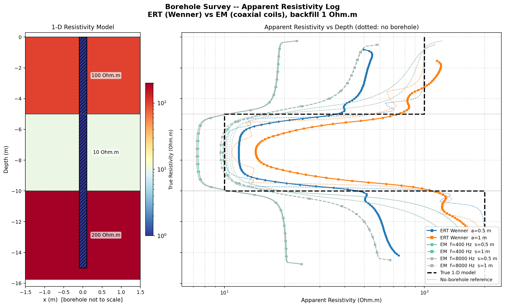
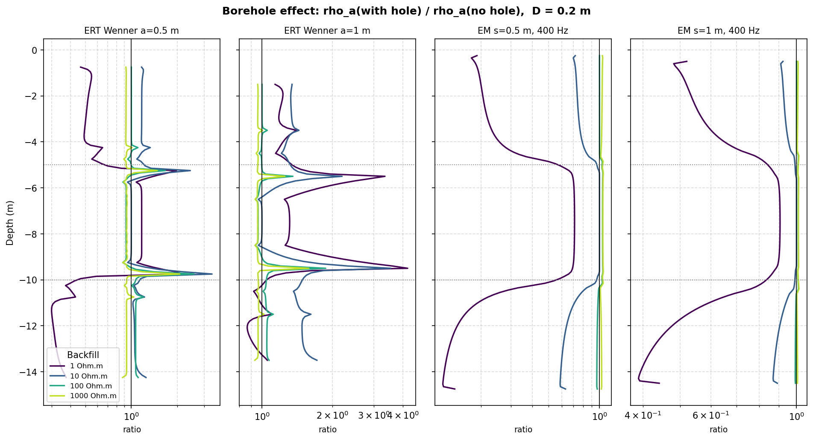

# PyBorehole: borehole backfill effect on resistivity and induction logs

PyBorehole simulates what a borehole **resistivity tool (ERT, PyGIMLi)** and an **electromagnetic induction tool (FDEM, SimPEG)** measure in a backfilled borehole through a layered earth. Both tools are simulated in 3D, with and without the borehole, so you can see how much the backfill distorts each log.

You provide:

- the layered earth model (depths and resistivities),
- the borehole diameter and length, and the backfill resistivity (or several concentric zones such as casing + gravel pack),
- the electrode spacings (ERT) and the coil spacings and frequencies (EM).

You get apparent-resistivity logs for every tool, the no-borehole reference logs, and the **borehole effect**: the ratio of the two.



---

## Start here: `run_combined.py`

**[`run_combined.py`](run_combined.py) is the main file.** It runs the complete study: ERT and EM, with and without the borehole, for a sweep of backfill resistivities, and saves all the figures. Usually you only edit its `SETTINGS` block and run it.

### 1. Install

PyGIMLi needs the `tetgen` mesh generator, which is easiest to get from conda:

```bash
conda create -n pyborehole -c gimli -c conda-forge python=3.10 pygimli tetgen
conda activate pyborehole
pip install -r requirements.txt
```

Check that `tetgen` is found (`tetgen -h`). If it isn't, ERT meshing fails with `No such file or directory: '...-1.node'`.

### 2. Edit the settings

Open `run_combined.py` and edit the block at the top:

```python
LAYERS = np.array([          # [top_depth, bottom_depth, resistivity]; last layer extends down
    [0.0,   5.0,  100.0],
    [5.0,  10.0,   10.0],
    [10.0, 15.0,  200.0],
])

BOREHOLE_LENGTH = 15.0
BOREHOLE_DIAM   = 0.20
BACKFILL_RES    = 10.0                       # always included in the sweep
BACKFILL_SWEEP  = [1.0, 10.0, 100.0, 1000.0]  # one combined_log_backfill_<rho>.png each

ERT_SHORT_SPACING = 0.5
ERT_LONG_SPACING  = 1.0
ERT_MEAS_SPACING  = 0.1

EM_COIL_SPACINGS  = [0.5, 1.0]
EM_FREQUENCIES    = [400.0, 8000.0]
EM_MEAS_SPACING   = 0.1
EM_MESH_TYPE      = "cylindrical"

OUTPUT_DIR        = "results"               # all figures are written here
```

| Setting | Meaning |
|---|---|
| `LAYERS` | One row per layer: top depth (m), bottom depth (m), resistivity (Ohm.m). Depths are positive downward from the surface. The first layer must start at 0; the last layer continues to the bottom of the model. |
| `BOREHOLE_LENGTH`, `BOREHOLE_DIAM` | Borehole depth and diameter (m). The borehole is vertical and starts at the surface. |
| `BACKFILL_SWEEP` | Backfill resistivities (Ohm.m) to simulate. Each value costs one ERT solve (about 1–2.5 min). |
| `BACKFILL_RES` | A backfill value that is always simulated, even if it isn't in the sweep. |
| `ERT_SHORT_SPACING`, `ERT_LONG_SPACING` | Wenner electrode spacings *a* (m). The array is A–M–N–B with spacing *a* between neighbours, so it is 3*a* long. |
| `ERT_MEAS_SPACING` | Electrode step along the hole (m). Spacings must be multiples of it. |
| `EM_COIL_SPACINGS` | Transmitter–receiver distances (m) of the coaxial induction coils. |
| `EM_FREQUENCIES` | EM frequencies (Hz). |
| `EM_MEAS_SPACING` | Step of the EM tool along the hole (m). |
| `EM_MESH_TYPE` | `"cylindrical"` (axisymmetric, a full log in seconds; use this for a centred tool) or `"tree"` (full 3D octree, ~10 s per tool position and frequency; for an off-centre tool, see the user guide). |
| `OUTPUT_DIR` | Folder for the figures. |

### 3. Run

```bash
conda activate pyborehole
python run_combined.py
```

With the default settings this takes about **8–12 minutes** and needs about **12 GB of RAM**, almost all of it for the 3D ERT solves. The EM simulations take seconds.

What the script does:

1. **ERT:** builds one 3D mesh (borehole, layers and electrodes are built into it), then solves for the no-borehole reference and for every backfill value in the sweep, reusing the mesh.
2. **EM:** solves the same model on an axisymmetric cylindrical mesh, with and without the borehole, for every backfill value.
3. **Plots:** one log figure per backfill value, plus one summary figure of the borehole effect.
4. **Table:** prints the borehole effect at the middle of every layer.

### 4. Read the results

All figures go to `results/`:

| File | What it shows |
|---|---|
| `combined_log_backfill_<rho>.png` | One per backfill value. Left: the model. Right: apparent resistivity versus depth for every tool. Solid = with the backfilled hole, dotted = the same tool without a hole, dashed black = true formation resistivity. |
| `backfill_effect.png` | One panel per tool, one curve per backfill value: ρa(with hole) / ρa(no hole). **1 = no effect**; below 1 the hole makes the tool read too low, above 1 too high. |



Depth on all plots is the **centre of the tool**: the midpoint of the Wenner array, or the midpoint between the transmitter and receiver coils.

The printed table looks like this (default model, D = 0.2 m):

```
 layer_rho  depth  backfill  ERT a=0.5  ERT a=1  EM s=0.5  EM s=1
     100.0    2.5       1.0      0.512    1.199     0.210   0.549
     100.0    2.5     100.0      1.000    1.000     1.000   1.000
     200.0   12.5       1.0      0.315    0.887     0.135   0.445
     ...
```

What these default results show:

- A **conductive backfill** (1 Ohm.m) has a large effect on the short induction coils: s = 0.5 m reads 5–7 times too low. Longer coils are much less affected.
- The **ERT Wenner** array reads too low at short spacing and can *overshoot* the true value at longer spacing (ratio > 1). This is real Wenner behaviour in a conductive hole and matches the analytic solution.
- A **resistive backfill** (1000 Ohm.m) changes ERT by 4–8% and EM by only 1–5%.
- When the backfill equals the formation, every ratio is exactly 1, as it should be.

---

## Using the classes directly

`run_combined.py` is built on two classes you can also use on their own:

```python
import numpy as np
from geometry_class import Geometry, EMGeometry

layers = np.array([[0, 5, 100], [5, 10, 10], [10, 15, 200]], dtype=float)

# ERT
geo  = Geometry(borehole_length=15, borehole_diameter=0.2, layer_1d_geometry=layers,
                backfill_resistivity=10.0, long_spacing=1.0)
plc  = geo.make_basic_geometry()
data = geo.make_array(plc, abmn_order=(1, 4, 2, 3), short_spacing=0.5,
                      long_spacing=1.0, measuring_spacing=0.1)
mesh = geo.make_mesh(plc)
with_hole = geo.run(mesh, data)                        # pygimli DataContainer, 'rhoa' column
no_hole   = geo.run(mesh, data, include_borehole=False)
geo.set_borehole(backfill_resistivity=1000.0)          # new backfill, same mesh

# EM
em = EMGeometry(borehole_length=15, borehole_diameter=0.2, layer_1d_geometry=layers,
                backfill_resistivity=10.0, frequencies=[400, 8000], coil_spacings=[0.5, 1.0])
log    = em.run()                                      # pandas DataFrame
log_nh = em.run(include_borehole=False)
```

Instead of a single backfill you can give concentric zones `(outer_radius, resistivity[, top, bottom])`, for example a water-filled PVC casing inside a gravel pack:

```python
zones = [(0.045, 20.0),            # r < 4.5 cm: water inside the casing
         (0.050, 1e6),             # 5 mm PVC wall (insulating)
         (0.100, 30.0, 2.0, 15.0)] # gravel pack, 30 Ohm.m, from 2 to 15 m depth
geo = Geometry(..., borehole_zones=zones)
em  = EMGeometry(..., borehole_zones=zones)
```

(A closed PVC wall blocks the ERT current, as in reality; galvanic tools only see the formation through open hole or a slotted screen.)

**See [docs/user_guide.md](docs/user_guide.md)** for all parameters, outputs, accuracy and run-time settings, the physics, and troubleshooting.

---

## Validation

The simulators are checked against exact solutions (`pytest tests/`; add `-m "not slow"` to skip the 3D ERT tests, which take about 5 minutes):

| Check | Reference | Result |
|---|---|---|
| ERT Wenner in a 0.2 m borehole, backfill 1 and 1000 Ohm.m in 100 Ohm.m, a = 0.1–1 m | Fourier–Bessel solution for an infinite borehole | within 0.1% |
| ERT in a layered model (100/10/200 Ohm.m), with and without the hole | 1.7× finer mesh | within 0.04% |
| ERT without borehole | homogeneous half-space | exact |
| EM coaxial coils in a full space (1–100 Ohm.m), 400 and 8000 Hz | analytic dipole field | quadrature and apparent resistivity within ~1.5% |
| EM coaxial coils in a 0.2 m borehole, backfill 1–1000 Ohm.m | Fourier–Bessel solution for an infinite borehole | quadrature within 0.1–1.7% (cylindrical), 0.1–1.5% (3D octree) |
| EM coplanar coils in a full space, 3D octree | analytic dipole field | within 0.7% |

## Limitations

- The borehole is vertical and the layers are horizontal.
- The ERT tool sits on the borehole axis. The EM tool can be off-centre (`tool_offset`, 3D octree mesh). The tool body (mandrel) is not modelled.
- ERT uses a Wenner-type array (any A, B, M, N order on equally spaced electrodes). Normal and lateral arrays are not implemented yet.
- The default EM solver is axisymmetric (exact for a centred coaxial tool in flat layers). The 3D octree solver handles off-centre tools and transverse coils but takes ~10 s per tool position and frequency, so it is meant for selected depths rather than full logs.
- EM `real`, `amplitude` and `phase` are not meaningful at these low induction numbers (the in-phase secondary field is ~1e-8 of the primary); use the quadrature (`imag`) or the apparent resistivity.

## Repository layout

```
run_combined.py               main script: ERT + EM backfill study  <- start here
geometry_class/
    geometry.py               ERT: 3D mesh, electrodes, PyGIMLi forward model
    em_geometry.py            EM: cylindrical / octree mesh, SimPEG forward model
    borehole_model.py         shared resistivity model (layers, borehole zones, air)
    analytic.py               exact reference solutions used by the tests
tests/test_validation.py      validation against the analytic solutions
docs/user_guide.md            full documentation
results/                      figures written by run_combined.py
demo.ipynb                    older ERT-only notebook demo
```
