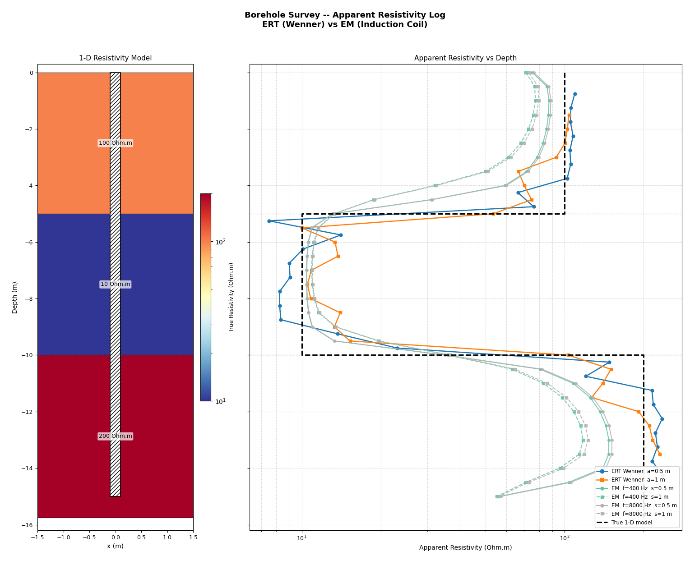
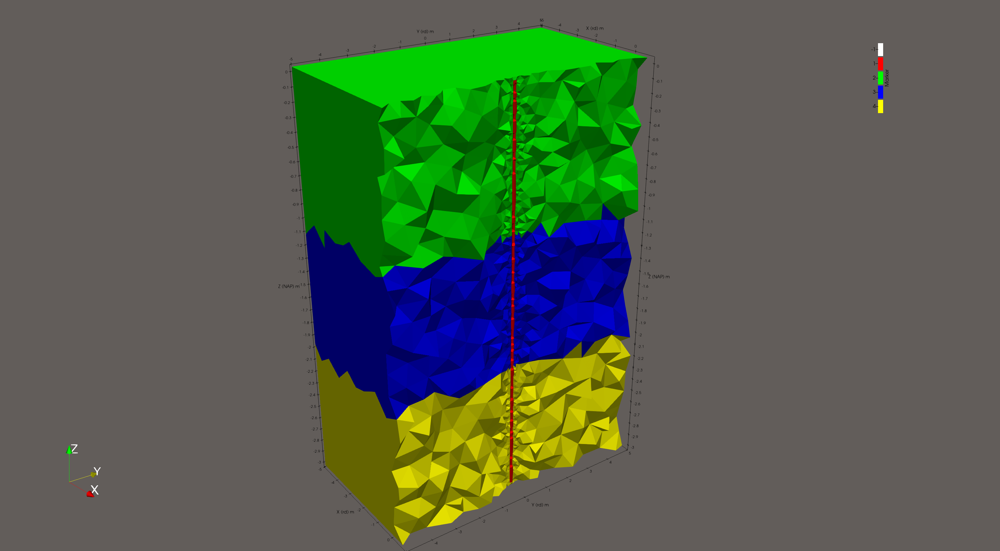

# PyBorehole ERT + EM Simulator

PyBorehole is a Python-based utility designed to define geometries, generate meshes, and simulate 3D Electrical Resistivity Tomography (ERT) measurements tailored for borehole and cross-hole environments. It leverages the **PyGIMLi** framework for robust finite-element forward modeling and **PyVista** / Matplotlib for visualizations.

## Features

- **Shared borehole model** (`geometry_class/borehole_model.py`): 1D layered formation (last layer extends to infinite depth), concentric borehole zones (backfill, casing, gravel pack, ...; each with its own radius, resistivity and depth interval) and air. ERT and EM read the same model, so their logs are directly comparable.
- **3D ERT (PyGIMLi)**: concentric polygonal PLC (equal-area to the true circles) with borehole zones, a refined near zone, a medium zone and the far field; every layer interface and zone boundary is an exact mesh face. Quadratic (P2) elements, singularity removal, no-flux surface and mixed far-field boundaries.
- **3D FDEM (SimPEG)**: coaxial (or coplanar) magnetic-dipole coils on an axisymmetric `CylindricalMesh` whose radial cells line up with every zone radius; resistive air; outer boundary at least 3 skin depths away. An OcTree path exists for non-axisymmetric cases.
- **Borehole effect**: every simulation can be repeated with `include_borehole=False`; the ratio of the two logs is the effect of the hole/backfill. `run_combined.py` sweeps the backfill resistivity.
- **Validated** against analytic solutions (see below).

## Workflow

```python
from geometry_class import Geometry, EMGeometry

geo = Geometry(borehole_length=15, borehole_diameter=0.2, layer_1d_geometry=layers,
               backfill_resistivity=10.0, long_spacing=1.0)
plc  = geo.make_basic_geometry()
data = geo.make_array(plc, abmn_order=(1, 4, 2, 3), short_spacing=0.5,
                      long_spacing=1.0, measuring_spacing=0.1)
mesh = geo.make_mesh(plc)
with_hole = geo.run(mesh, data)
no_hole   = geo.run(mesh, data, include_borehole=False)
geo.set_borehole(backfill_resistivity=1000.0)   # same mesh, new backfill

em = EMGeometry(borehole_length=15, borehole_diameter=0.2, layer_1d_geometry=layers,
                backfill_resistivity=10.0, frequencies=[400, 8000], coil_spacings=[0.5, 1.0])
em_log = em.run()            # 'depth' = TX-RX midpoint
```

Use `borehole_zones=[(r_outer, rho[, top[, bottom]]), ...]` instead of `backfill_resistivity` for e.g. a PVC casing inside a gravel or bentonite annulus. The tool itself is not modelled: electrodes and coils sit on the borehole axis.

## Physics and validation

`pytest tests/` (add `-m "not slow"` to skip the 3D ERT solves):

| Check | Reference | Result |
|---|---|---|
| ERT Wenner in a 0.2 m borehole, backfill 1 and 1000 Ohm.m in 100 Ohm.m | Fourier-Bessel infinite-borehole solution | within 0.1 % |
| ERT no-borehole reference | homogeneous half-space | exact |
| EM coaxial coils in a full space, 400 / 8000 Hz | analytic dipole field | quadrature within ~1.5 % |
| EM borehole effect | 4x radially refined mesh | within 1.5 % |

Notes:
- ERT apparent resistivity uses the analytic half-space geometric factor (electrode images at the surface), so a homogeneous earth returns its true resistivity.
- EM apparent resistivity is the low-induction-number value from the quadrature field, with full-space coefficients (k = 4 pi coaxial, 8 pi coplanar). SimPEG uses the e^{+i omega t} convention.
- P1 elements leave a few-percent bias for strong borehole contrasts; keep `p2=True`.

## Visualizing the Results

### 2D Model Slice & Depth Profile
Below is the standard dual-view Matplotlib output, displaying a slice of the 1D Layer model highlighting the localized highly conductive borehole. On the right, the apparent resistivity profiles reflect short spacing vs. long spacing protocols measuring through those boundary limits.



### 3D Resistivity Mesh View
Below is a visual representation of the highly resolved inner core mesh accurately mapped with distinct resistivity volumes conforming structurally around the borehole interfaces.



### Demo & Usage
To try out and interact with this package, you can use the demo.ipynb Jupyter Notebook included in this repository.

>Note: The demo.ipynb file is currently a work in progress, but it provides a great starting point to see how to configure the geometry, run the mesh generator, and plot the simulated ERT data.

## Installation & Requirements

To run this package, you will need to install the dependencies outlined in `requirements.txt`.

```bash
pip install -r requirements.txt
```